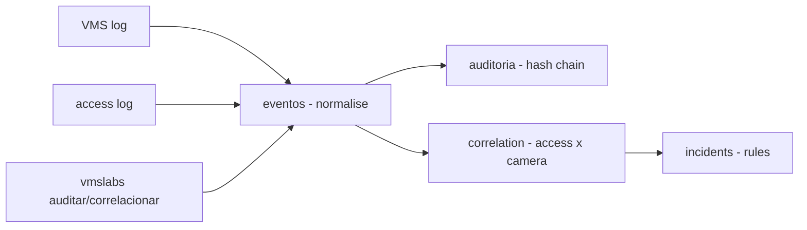

# vms-integration-labs

**English** · [Português (Brasil)](README.md)

[](#) [](#) [](#) [](LICENSE)

## What it is

**A VMS integration lab** (Video Management System): it imports logs from **cameras and access control** events, **normalises** them, **audits** with a linked hash chain (merkle-like), **correlates** access × camera and **detects incidents** by rules (e.g. door access without a matching camera feed, duplicate cards in the same period). It is an educational physical-security lab.

## Status

An educational lab, working and tested (41 tests).

## Features

- **Events** (`eventos.py`): `normalizar(raw_event, "vms"|"acesso")` → a standardised `Evento`; `carregar(path, system)`.
- **Audit** (`auditoria.py`): a trail with `acrescentar` (previous hash + current record chained), `verificar` (integrity), `montar` (converts event list into a trail).
- **Correlation** (`correlacao.py`): `pares_por_cartao`, `correlacionar` (crosses access × VMS), `acessos_sem_camera`, `cartoes_duplicados`.
- **Incidents** (`incidentes.py`): `RegraIncidente` loaded from YAML, `detectar(rules, events)` → `Incidente`.
- **CLI** (`vmslabs`): `correlacionar` and `auditar`.

## Architecture

A `vmslabs` package with `eventos` (normalisation/load), `auditoria` (hash chain), `correlacao` (access×VMS cross) and `incidentes` (YAML rules).



## Stack

- Python ≥ 3.10
- PyYAML ≥ 6.0 (only dependency)
- pytest (dev)

## Repository layout

```
vms-integration-labs/
├── pyproject.toml · BRIEF.md
├── src/vmslabs/
│   ├── eventos.py     # normalisation + log load
│   ├── auditoria.py   # linked hash chain
│   ├── correlacao.py  # access × camera
│   ├── incidentes.py  # rule-based detection
│   └── cli.py · __main__.py
├── dados/             # sample logs
├── tests/             # 41 tests
└── LICENSE            # MIT
```

## Prerequisites and installation

```bash
pip install -e .
```

## How to run

```bash
vmslabs auditar dados/
vmslabs correlacionar dados/
```

## Tests and quality

Real command (verified by the agent):

```bash
PYTHONPATH=src python -m pytest tests/
# 41 passed
```

## Technical decisions and trade-offs

- **Linked hash chain** (previous hash + record): auditable integrity proving event consistency.
- **Card-based correlation**: access × camera in the same period; `acessos_sem_camera` and `cartoes_duplicados` are practical physical-security detections.
- **Sample logs in dados/**: ready to test without real equipment.

## Known limitations and roadmap

- Static sample logs — no real VMS or turnstile connection.
- Simple YAML incident rules; no video analysis (motion, face).

## Development process

An individual project by Kelvin Oliveira, built with orchestrated AI agents and reviewed by the author.

## License and author

MIT — Copyright (c) 2026 Kelvin Rebelo de Oliveira. Author: [Kelvin Oliveira](https://github.com/KelvinOliveiraCode) · [Portfolio](https://kelvinoliveiracode.github.io/portfolio/)
