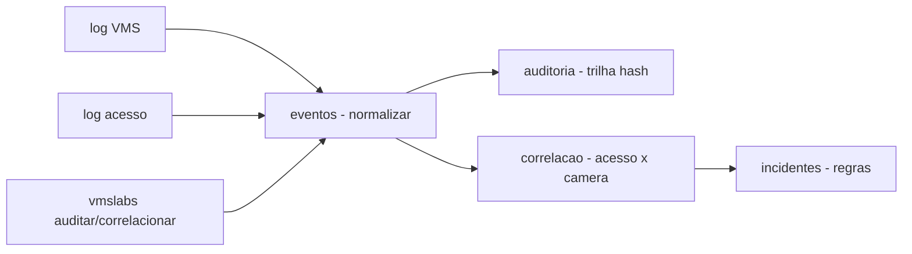

# vms-integration-labs

[English](README.en.md) · **Português (Brasil)**

[](#) [](#) [](#) [](LICENSE)

## O que é

**Laboratório de integração VMS** (Video Management System): importa logs de eventos de **câmeras e controle de acesso**, **normaliza** os eventos, **audita** com trilha hash encadeada (merkle-like), **correlaciona** acesso × câmera e **detecta incidentes** por regras (ex.: acesso sem câmera associada, cartão duplicado no mesmo período). É um laboratório educacional de segurança física.

## Status

Laboratório educacional funcional e testado (41 testes).

## Funcionalidades

- **Eventos** (`eventos.py`): `normalizar(evento_raw, "vms"|"acesso")` → `Evento` padronizado; `carregar(caminho, sistema)`.
- **Auditoria** (`auditoria.py`): trilha com `acrescentar` (hash do anterior + dados atuais encadeado), `verificar` (integridade), `montar` (converte lista de eventos em trilha).
- **Correlação** (`correlacao.py`): `pares_por_cartao`, `correlacionar` (cruza acesso × VMS), `acessos_sem_camera`, `cartoes_duplicados`.
- **Incidentes** (`incidentes.py`): `RegraIncidente` carregada de YAML, `detectar(regras, eventos)` → `Incidente`.
- **CLI** (`vmslabs`): `correlacionar` e `auditar`.

## Arquitetura

Pacote `vmslabs` com `eventos` (normalização/carga), `auditoria` (trilha hash), `correlacao` (cruzamento acesso×VMS) e `incidentes` (regras YAML).



## Stack

- Python ≥ 3.10
- PyYAML ≥ 6.0 (única dependência)
- pytest (dev)

## Estrutura do repositório

```
vms-integration-labs/
├── pyproject.toml · BRIEF.md
├── src/vmslabs/
│   ├── eventos.py     # normalização + carga de logs
│   ├── auditoria.py   # trilha hash encadeada
│   ├── correlacao.py  # acesso × câmera
│   ├── incidentes.py  # detecção por regras
│   └── cli.py · __main__.py
├── dados/             # logs de exemplo
├── tests/             # 41 testes
└── LICENSE            # MIT
```

## Pré-requisitos e instalação

```bash
pip install -e .
```

## Como executar

```bash
vmslabs auditar dados/
vmslabs correlacionar dados/
```

## Testes e qualidade

Comando real (verificado pelo agente):

```bash
PYTHONPATH=src python -m pytest tests/
# 41 passed
```

## Decisões técnicas e trade-offs

- **Trilha hash encadeada** (hash anterior + registro): integridade auditável entrega prova de consistência dos eventos.
- **Correlação por cartão**: acesso × câmera no mesmo período; `acessos_sem_camera` e `cartoes_duplicados` são detecções práticas de segurança física.
- **Logs de exemplo em dados/**: pronto para testar sem equipamento real.

## Limitações conhecidas e roadmap

- Logs estáticos (exemplos) — sem conexão real com VMS ou catraca.
- Regras de incidente simples (YAML); não cobre análise de vídeo (motion, rosto).

## Processo de desenvolvimento

Projeto individual de Kelvin Oliveira, construído com agentes de IA orquestrados e revisado pelo autor.

## Licença e autor

MIT — Copyright (c) 2026 Kelvin Rebelo de Oliveira. Autor: [Kelvin Oliveira](https://github.com/KelvinOliveiraCode) · [Portfólio](https://kelvinoliveiracode.github.io/portfolio/)
